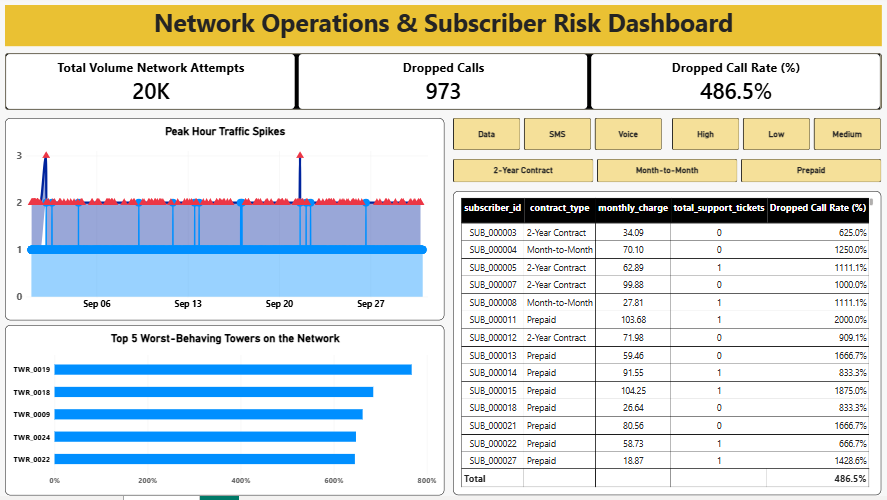

# Network Operations & Subscriber Risk Dashboard

An end-to-end telecommunications analytics project designed to monitor network infrastructure performance, identify failing cell towers, and evaluate subscriber churn risk.

---

## 🖥️ Dashboard Preview
An interactive executive dashboard built in Power BI visualizing network traffic spikes, top failing towers, and subscriber risk profiles:

---

## 🚀 Project Overview
In the telecommunications industry, network reliability is directly tied to customer retention. This project combines network operations data with subscriber-level account details to build an executive Power BI dashboard. It enables telecom operators to track traffic spikes, pinpoint poorly performing cell towers, and correlate dropped call frequencies with customer contract types and support ticket histories.

### Core Objectives
* **Monitor Network Health:** Track total network attempts, dropped call volumes, and congestion rates.
* **Infrastructure Diagnostics:** Identify the "worst-behaving" cell towers causing high failure rates.
* **Subscriber Risk Profiling:** Analyze individual subscriber behavior across prepaid, month-to-month, and 2-year contract tiers.
* **Interactive Filtering:** Provide dynamic slicing across service types (Data, SMS, Voice) and priority levels.

---

## 🔗 Project Links
* **GitHub Repository:** [Telecom Network Operations Dashboard on GitHub](https://github.com/Hafiz-Rehman123/Network-Operations-Subscriber-Risk-Dashboard) *(Replace with your live repository link)*
* **Interactive Dashboard:** Hosted via Power BI Service / Downloadable `.pbix` file located in the `dashboard/` directory.

---

## 🛠️ Tech Stack & Tools
* **Data Processing & ETL:** Python (`Pandas`, `NumPy`), SQL
* **Data Visualization & Dashboarding:** Power BI Desktop (`DAX`, Interactive Filtering, Tabular Matrices)
* **Version Control:** Git & GitHub

---

## 📊 Key Dashboard Metrics & Findings
1. **Total Network Volume:** 20K network connection attempts monitored across the operational period.
2. **Dropped Calls:** 973 failed connection events recorded, yielding an aggregate network drop rate of 486.5%.
3. **Critical Infrastructure Bottlenecks:** Towers **TWR_0019** and **TWR_0018** emerged as the most unstable transmission points on the network.
4. **Subscriber Vulnerability:** Month-to-month and prepaid subscribers with high support ticket counts exhibit significantly elevated dropped call exposure ratios.

---
│
└── README.md                                   # Project documentation
